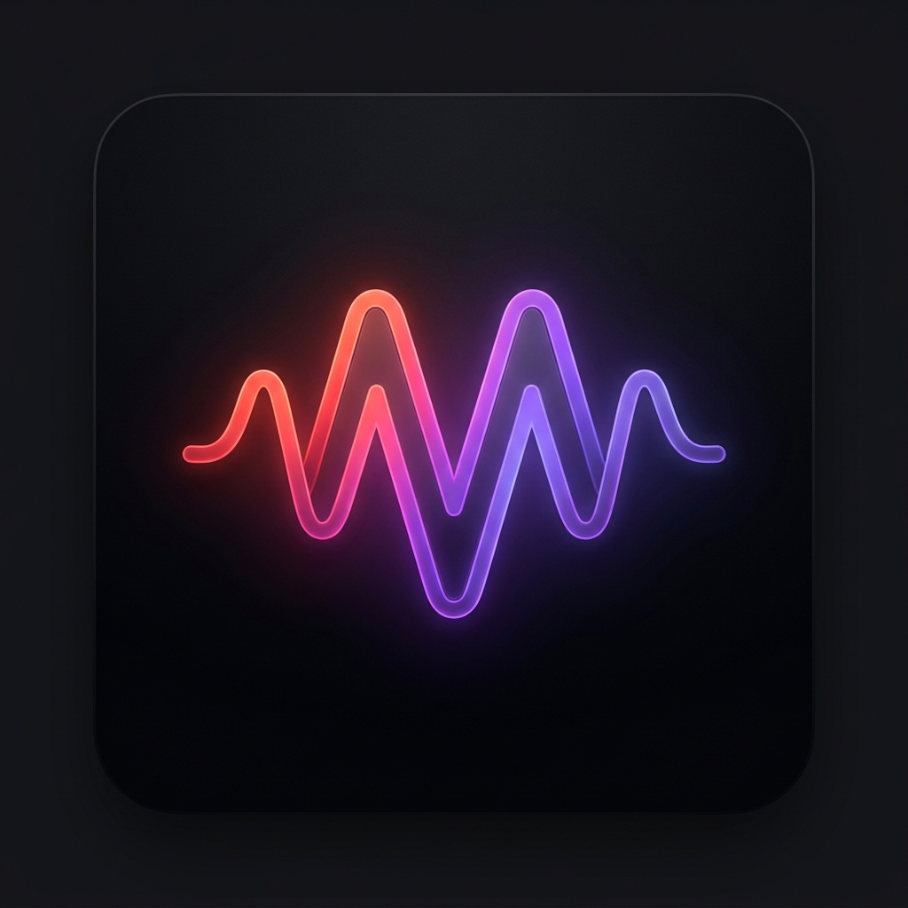

<div align="center">
  
  <h1>Mihon</h1>
  <p><strong>Ultra-fast, modern desktop music player built with Next.js 15, Tailwind CSS, and Tauri v2 (Rust).</strong></p>

  <p>
    <a href="https://github.com/ArtoMoon/Mihon/releases/latest">
      
    </a>
    
    
    
  </p>
</div>

---

## ✨ Features

- **⚡ Zero-Latency Audio Caching & Playback**: Pre-fetches and caches high-bitrate audio streams locally for instant, gapless playback and offline replay.
- **🎧 Spotify Profile & Playlist Import**: Import any public Spotify playlist (`open.spotify.com/playlist/...`) or an entire user profile (`open.spotify.com/user/...`) with a single click—no API keys required.
- **🔮 Acoustic Similar-Genre Radio (AI Vibe Engine)**: Generates a continuous radio stream of similar songs using YouTube Music's `RDAMVM` acoustic graph combined with Maximal Marginal Relevance (MMR) artist diversity scoring.
- **💬 Native Discord Rich Presence**: Displays the currently playing track, artist, high-resolution album cover, live elapsed/remaining timestamps, and a direct GitHub link on your Discord profile via Windows Named Pipe IPC (`\\.\pipe\discord-ipc-*`).
- **🔄 Built-in GitHub Auto-Updater**: Checks [`ArtoMoon/Mihon`](https://github.com/ArtoMoon/Mihon) for new releases and updates the binary in-place with one click.
- **💾 Persistent Local Library**: Automatically persists custom playlists, liked tracks, and listening history to disk (`library.json`).
- **🎛️ Variable Playback Speed & Logarithmic Volume Curve**: Supports `0.75x`, `1x`, `1.25x`, `1.5x`, and `2x` playback speeds with perceptual loudness normalization.

---

## 📦 Download & Installation

Download the latest version from the [**GitHub Releases**](https://github.com/ArtoMoon/Mihon/releases/latest) page:

| Package | Description |
| :--- | :--- |
| **`Mihon_2.1.0_x64-setup.exe`** | Standard Windows NSIS Setup Installer (creates desktop & Start Menu shortcuts) |
| **`Mihon.exe`** | Standalone Portable Executable (no installation required) |

---

## 🛠️ Tech Stack

- **Frontend**: Next.js 15 (App Router, Static Export), React 19, Tailwind CSS, Lucide Icons
- **Backend / Native Core**: Rust, Tauri v2, Tokio, Reqwest
- **Audio Engine**: Native Rust stream resolver + local disk cache (`%LOCALAPPDATA%\com.helios.player`)
- **Discord Integration**: Zero-dependency Rust IPC Named Pipe client (`src-tauri/src/discord.rs`)

---

## 🚀 Development & Building from Source

### Prerequisites
- [Node.js](https://nodejs.org/) (v18+)
- [Rust & Cargo](https://rustup.rs/) (stable)
- Windows 10/11 with WebView2 runtime

### 1. Install Dependencies
```bash
cd spo-tauri
npm install
```

### 2. Run in Development Mode
```bash
npm run dev
```

### 3. Build Standalone `Mihon.exe` & NSIS Setup Installer
```bash
cd spo-tauri
npm run build
npx tauri build --bundles nsis
```

---

## 📄 License

Distributed under the MIT License. See [`https://github.com/ArtoMoon/Mihon`](https://github.com/ArtoMoon/Mihon) for more information.
